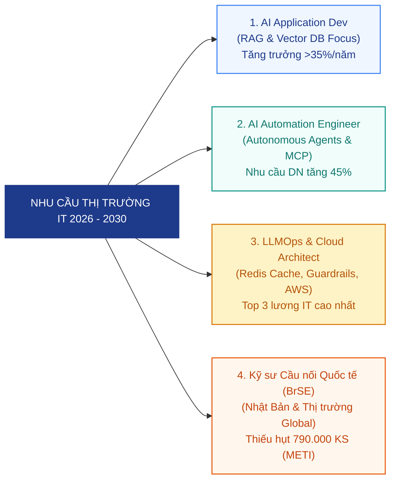
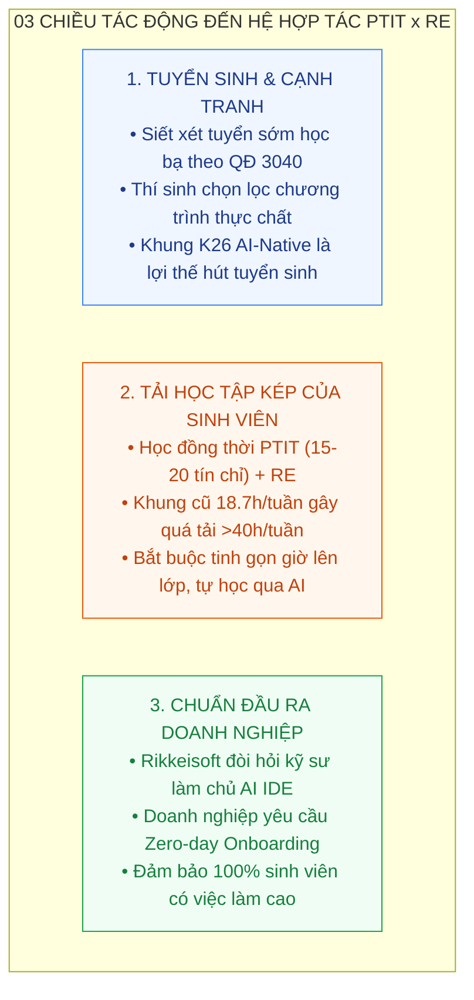
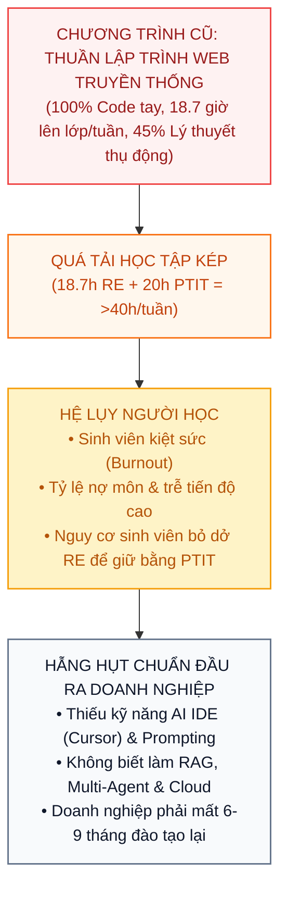
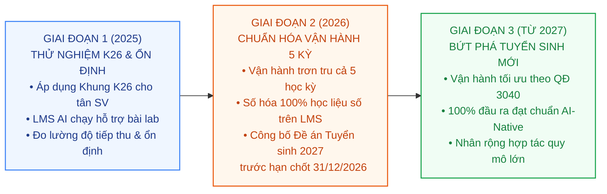

# BÁO CÁO CHIẾN LƯỢC: CẢI TIẾN CHƯƠNG TRÌNH ĐÀO TẠO CNTT
## HỆ HỢP TÁC RIKKEI EDUCATION & HỌC VIỆN CÔNG NGHỆ BƯU CHÍNH VIỄN THÔNG (PTIT)
**Đón Đầu Quy Chế Tuyển Sinh 2027 & Chuẩn Hóa Khung Năng Lực AI Kỷ Nguyên Mới Cho Khóa K26**

* **Đơn vị chủ trì**: Bộ môn Công nghệ Thông tin – Rikkei Education (Rikkeisoft)
* **Đối tác liên kết**: Học viện Công nghệ Bưu chính Viễn thông (PTIT)
* **Đối tượng đào tạo**: Sinh viên hệ đào tạo liên kết chuyên ngành Công nghệ Thông tin (Hệ PTIT x RE)
* **Thời gian lập báo cáo**: Tháng 10/2026

---

### MỤC LỤC BÁO CÁO

* **PHẦN 1: DỰ BÁO XU HƯỚNG GIÁO DỤC ĐẠI HỌC SẮP TỚI VÀ ĐÁNH GIÁ ẢNH HƯỞNG ĐẾN HỆ PTIT CỦA RE**
  * 1.1. Dự báo 04 Xu hướng Lớn của Giáo dục Đại học (2026 – 2030)
  * 1.2. Dự báo Nhu cầu Ngành nghề CNTT & Xu thế Kỹ sư AI-Native Toàn cầu
  * 1.3. Đánh giá Ảnh hưởng Trực tiếp đến Hệ PTIT của Rikkei Education (03 Chiều tác động)
* **PHẦN 2: ĐÁNH GIÁ NỘI DUNG ĐÀO TẠO HIỆN TẠI VÀ CÁC PHÂN TÍCH, ĐỀ XUẤT ĐIỀU CHỈNH**
  * 2.1. Đánh giá Nội dung Đào tạo Hiện tại (Chương trình cũ) & 03 Điểm nghẽn Cốt tử
  * 2.2. Phân tích Nguyên nhân & Cơ sở Khoa học để Tinh gọn và Hiện đại hóa
  * 2.3. Đề xuất Điều chỉnh Toàn diện: Công bố Khung Chương trình Đào tạo Mới K26 (Học kỳ I đến Học kỳ V)
  * 2.4. Chi tiết Cấu trúc Học phần Khung Mới K26: Sơ đồ Kế thừa, Năng lực AI & Sản phẩm Đầu ra
  * 2.5. Khai thác Hạ tầng LMS AI Khả thi Hỗ trợ Học tập & Lộ trình Thích ứng Dần 03 Giai đoạn
* **PHẦN 3: CÁC NỘI DUNG TRỌNG TÂM THẢO LUẬN VỚI HỘI ĐỒNG PTIT**
* **PHẦN 4: HỆ THỐNG CĂN CỨ PHÁP LÝ & TÀI LIỆU THAM KHẢO**

---

# PHẦN 1: DỰ BÁO XU HƯỚNG GIÁO DỤC ĐẠI HỌC SẮP TỚI VÀ ĐÁNH GIÁ ẢNH HƯỞNG ĐẾN HỆ PTIT CỦA RE

---

## 1.1. Dự báo 04 Xu hướng Lớn của Giáo dục Đại học (Giai đoạn 2026 – 2030)

Giáo dục đại học Việt Nam, đặc biệt trong khối ngành Công nghệ Thông tin (CNTT) và Kỹ thuật, đang bước vào chu kỳ tái cấu trúc sâu rộng dưới tác động đồng thời của chính sách quản lý nhà nước và làn sóng đột phá công nghệ:

### 1. Xu hướng Siết chặt Quy chế & Minh bạch hóa Tuyển sinh (Căn cứ Quyết định 3040/QĐ-BGDĐT)
* **Bãi bỏ hoàn toàn các kỳ xét tuyển sớm tự do**: Bộ GD&ĐT quy định từ kỳ tuyển sinh 2027, các cơ sở giáo dục đại học không được tổ chức xét tuyển sớm tràn lan bằng học bạ THPT tự do; toàn bộ quy trình xét tuyển được đồng bộ tập trung trên cổng tuyển sinh quốc gia.
* **Giới hạn số lượng phương thức xét tuyển**: Mỗi ngành đào tạo chỉ được sử dụng tối đa **03 phương thức xét tuyển trong năm 2027**, và tiến tới rút gọn còn **01 phương thức duy nhất từ năm 2028**.
* **Chuẩn hóa công bằng & Bỏ điểm cộng tự đặt**: Quy chế chấm dứt việc các trường tự đặt tiêu chí cộng điểm ưu tiên không đồng nhất, siết chặt chất lượng nguồn tuyển đầu vào thực chất.
* **Thời hạn công bố bắt buộc**: Đề án tuyển sinh năm 2027 phải được các trường ban hành và công bố công khai trước ngày **31/12/2026**.

### 2. Xu hướng Chuyển đổi số Sang Mô hình AI-First & Blended Learning
* Giáo dục đại học trên toàn cầu đang chuyển dịch từ mô hình "thầy đọc - trò chép" truyền thống sang mô hình **Lớp học đảo ngược (Flipped Classroom)** và **Học tập cá nhân hóa (Adaptive Learning)**.
* Sinh viên thế hệ mới đòi hỏi tài liệu số hóa, môi trường thực hành trực quan và sự phản hồi tức thì 24/7 từ các trợ lý ảo AI thay vì phải chờ đợi giải đáp thủ công.
* Các trường đại học công nghệ hàng đầu đang số hóa tối đa khối lượng lý thuyết cơ sở lên nền tảng trực tuyến, dành trọn vẹn thời gian trên giảng đường cho thảo luận, giải quyết vấn đề và phát triển đồ án thực tế.

### 3. Xu hướng Tái định hình Năng lực Lập trình dưới tác động của GenAI & Agentic AI
* Theo báo cáo nghiên cứu của Gartner, đến năm 2028 có tới **75% kỹ sư phần mềm doanh nghiệp sẽ sử dụng các công cụ AI Code Assistant** (như Cursor, GitHub Copilot, Windsurf) trong công việc hàng ngày.
* Kỹ năng viết mã thủ công đơn thuần (syntax coding / boilerplate code) không còn là lợi thế cạnh tranh của nhân sự CNTT. Thay vào đó, thị trường lao động đòi hỏi kỹ sư phải nắm vững:
  * Năng lực ra lệnh chuyên nghiệp (Prompt Engineering, Context Caching, Token Management).
  * Kỹ năng làm việc cặp cùng AI (Pair-Programming) để đọc hiểu luồng code, gỡ lỗi và tái cấu trúc mã nguồn.
  * Năng lực làm chủ các kiến trúc AI hiện đại: Hệ thống RAG (Retrieval-Augmented Generation), Tác nhân tự hành (Autonomous Agents), Giao thức MCP (Model Context Protocol), và Đa tác nhân (Multi-Agent Systems).
  * Kỹ năng phân tích thiết kế hệ thống, kiểm thử tự động, tối ưu chi phí hạ tầng (Cost Governance) và bảo mật mã nguồn.

### 4. Xu hướng Đào tạo Gắn liền với Nhu cầu Thực chiến Doanh nghiệp (Work-Integrated Learning)
* Các doanh nghiệp công nghệ lớn không còn thời gian và nguồn lực để đào tạo lại sinh viên mới tốt nghiệp từ 6 đến 12 tháng. Tiêu chí tuyển dụng ưu tiên hàng đầu là **khả năng sẵn sàng làm việc ngay (Zero-day Onboarding)**.
* Sự hợp tác giữa trường đại học danh tiếng (PTIT) và doanh nghiệp công nghệ hàng đầu (Rikkeisoft/RE) là mô hình lý tưởng đón đầu xu thế này nếu chương trình đào tạo bám sát chuỗi dự án và công nghệ sản xuất phần mềm thực tế.

---

## 1.2. Dự báo Nhu cầu Ngành nghề CNTT & Xu thế Kỹ sư AI-Native Toàn cầu



### Bảng Thống kê Dự báo Nhu cầu & Xu thế Tuyển dụng CNTT:

| STT | Vị trí Nghề nghiệp (Job Role) | Trọng tâm Công nghệ Kỷ nguyên Mới | Tốc độ Tăng trưởng & Mức lương | Nguồn Dữ liệu & Dẫn chứng |
| :---: | :--- | :--- | :--- | :--- |
| **01** | **Kỹ sư Ứng dụng AI & RAG**<br>*(AI Application Developer)* | LLMs API, pgvector, LangChain, Embeddings, RAG Engine chống ảo giác | Tăng trưởng **>30%/năm**; Lương khởi điểm cao hơn 25% | **WEF Future of Jobs Report 2024** |
| **02** | **Kỹ sư Tự động hóa Agentic AI**<br>*(AI Automation & Agentic Dev)* | Single Agent, ReAct, Model Context Protocol (MCP), LangGraph Multi-Agent | Nhóm việc mới tăng trưởng **đột biến 45%** tại các tập đoàn lớn | **Gartner Tech Trends 2024–2028** |
| **03** | **Kỹ sư Vận hành LLMOps & Cloud**<br>*(LLMOps & Cloud Architect)* | Semantic Caching (Redis), Model Routing, NeMo Guardrails, AWS Cloud | **Top 3** vị trí có đãi ngộ cao nhất thị trường IT | **TopDev Vietnam IT Report 2024** |
| **04** | **Kỹ sư Cầu nối Quốc tế (BrSE)**<br>*(Bridge Software Engineer)* | Kiến trúc phần mềm, Quản trị Agile, Tiếng Nhật N3/N2, Kỹ năng làm việc Global | Nhật Bản thiếu hụt **790.000 kỹ sư** đến 2030; VN chiếm >50% ITO | **Bộ Kinh tế & Công nghiệp Nhật (METI)** |

---

## 1.3. Đánh giá Ảnh hưởng Trực tiếp đến Hệ PTIT của Rikkei Education



---

# PHẦN 2: ĐÁNH GIÁ NỘI DUNG ĐÀO TẠO HIỆN TẠI VÀ CÁC PHÂN TÍCH, ĐỀ XUẤT ĐIỀU CHỈNH

---

## 2.1. Đánh giá Nội dung Đào tạo Hiện tại (Chương trình cũ) & 03 Điểm nghẽn Cốt tử

Khảo sát chương trình đào tạo cũ (khung 2026 truyền thống gồm 5 học kỳ, 20.3 tháng, tổng 1.656 giờ) cho thấy những bất cập nghiêm trọng được tổng hợp trong bảng và sơ đồ phân tích dưới đây:

### Bảng Phân tích 03 Điểm nghẽn Cốt tử của Chương trình Đào tạo Cũ:

| STT | Điểm nghẽn Cốt tử | Thực trạng Chương trình Cũ (Khung 2026) | Hệ lụy Thực tế Đối với Người học & Nhà trường | Định hướng Đột phá Khung K26 |
| :---: | :--- | :--- | :--- | :--- |
| **01** | **Lạc hậu về Công nghệ & Thiếu vắng AI** | • 100% nội dung xoay quanh lập trình Web Java truyền thống (C, Java OOP, Spring Boot cơ bản).<br>• Hoàn toàn không có nội dung về AI Prompting, Python/FastAPI, CSDL Vector, RAG, Tác nhân tự hành (Agents), MCP và LLMOps. | • Sinh viên tốt nghiệp thiếu hụt kỹ năng công nghệ cốt lõi của năm 2026.<br>• Mất lợi thế cạnh tranh khi tuyển dụng vào các dự án công nghệ mới của Rikkeisoft và đối tác quốc tế. | **Tái cấu trúc 100% AI-Native**: Đưa AI xuyên suốt từ Kỳ I (Prompting, Figma AI) đến Kỳ V (RAG, Multi-Agent MCP, LLMOps). |
| **02** | **Phương pháp Lập trình Thủ công, Năng suất Thấp** | • Đào tạo theo tư duy gõ code thủ công 100% từ đầu (Boilerplate code).<br>• Chưa tiếp cận phương pháp Pair-Programming với AI IDE (Cursor, Windsurf).<br>• Không được học kỹ năng quản lý ngữ cảnh (@Files, @Web, Context Caching) và kiểm định code AI. | • Tốc độ hoàn thành dự án chậm hơn từ 2 đến 3 lần so với kỹ sư sử dụng AI IDE.<br>• Sinh viên lúng túng khi đối mặt với lỗi mã nguồn do AI sinh ra (ảo giác cú pháp). | **Đào tạo Pair-Programming chuẩn mực**: Sinh viên thành thạo sử dụng AI IDE sinh code UI/API, tập trung tư duy vào kiểm thử, bảo mật và tối ưu logic. |
| **03** | **Thời lượng Quá tải & Thiếu Tính Kế thừa Dự án** | • Thời lượng học tại lớp **18.7 giờ/tuần**.<br>• Tỷ lệ lý thuyết tại lớp chiếm tới 40%–45%, giảng viên đọc slide lý thuyết lặp lại.<br>• Các bài tập lab nhỏ lẻ, thiếu tính liên kết kế thừa thành một sản phẩm hoàn chỉnh theo chuẩn Agile/Scrum. | • Tổng tải học tập (RE + PTIT) vượt **40 giờ/tuần** $\rightarrow$ Sinh viên kiệt sức (*burnout*), nợ môn, tỷ lệ bỏ dở RE tăng cao.<br>• Sinh viên ra trường không có Portfolio dự án sản phẩm quy mô doanh nghiệp. | **Tinh gọn giờ học & Học tập theo dự án (Product-Based Learning)**:<br>• Giảm giờ lý thuyết tại lớp, đưa lên LMS AI.<br>• Sản phẩm môn trước là đầu vào trực tiếp cho môn sau. |

---

### Sơ đồ Vòng xoáy Bất cập của Mô hình Đào tạo Cũ:



---

### Biểu đồ Thống kê So sánh Phân bổ Tải Học tập:

```
SO SÁNH TỔNG TẢI HỌC TẬP HÀNG TUẦN CỦA SINH VIÊN (GIỜ/TUẦN):

Chương trình Cũ:  [===== PTIT: 20h =====][===== RE: 18.7h (45% LT) =====] => 38.7h - 42h/tuần  [NGUY CƠ QUÁ TẢI ĐỎ]
Khung K26 Đề xuất: [===== PTIT: 20h =====][== RE Thực hành: 12h ==][LMS AI: 6h] => ~32h/tuần  [VÙNG CÂN BẰNG TỐI ƯU]
```

| Chỉ số Định lượng So sánh | Chương trình Đào tạo Cũ | Khung Mới K26 (Đề xuất) | Chênh lệch & Hiệu quả Cải tiến |
| :--- | :---: | :---: | :--- |
| **Thời lượng học trực tiếp tại lớp** | **18.7 giờ/tuần** | **12.0 – 14.0 giờ/tuần** | **Giảm 30%** áp lực trực tiếp tại giảng đường |
| **Tỷ lệ giờ Lý thuyết trực tiếp** | **40% – 45%** (Đọc slide) | **10% – 15%** (Đúc kết cốt lõi) | **Chuyển 80% lý thuyết** sang học chủ động qua LMS AI |
| **Tỷ lệ Thực hành & Đồ án thực chiến** | **55%** | **85% – 90%** | **Tập trung 100%** giờ trên lớp cho thực chiến & dự án |
| **Hỗ trợ giải đáp lỗi lập trình** | Chờ đến giờ lên lớp (Thủ công) | **AI Assistant 24/7 tức thì** | Sinh viên được sửa lỗi ngay, không bị nghẽn tự học |
| **Mức độ ứng dụng công nghệ AI** | **0%** (Hoàn toàn thủ công) | **Xuyên suốt 100% 5 học kỳ** | Chuẩn hóa năng lực Kỹ sư AI-Native thế hệ mới |

---

## 2.2. Phân tích Nguyên nhân & Cơ sở Khoa học để Tinh gọn và Hiện đại hóa

1. **Ứng dụng Mô hình Lớp học Đảo ngược (Flipped Classroom)**: Chuyển toàn bộ nội dung lý thuyết cú pháp sang video bài giảng ngắn và học liệu số trên LMS AI để sinh viên tự học chủ động. Dành trọn vẹn thời gian trên lớp cho thực hành giải quyết bài toán và phát triển đồ án.
2. **Nguyên tắc "AI-Assisted First" trong Kỹ thuật Phần mềm**: Thay vì bắt sinh viên tự gõ lại những đoạn mã lặp lại (Boilerplate code), đào tạo sinh viên tư duy kiến trúc, phân rã yêu cầu đặc tả (SRS) và chỉ huy AI sinh mã nguồn chuẩn xác, sau đó tự tay kiểm thử, gỡ lỗi và tối ưu hóa mã nguồn.
3. **Mô hình Đào tạo Tích lũy Kế thừa (Product-based Learning)**: Sản phẩm đầu ra của môn học trước trở thành đầu vào trực tiếp cho môn học sau, giúp sinh viên tích lũy và hoàn thiện sản phẩm phần mềm hoàn chỉnh (End-to-End) qua từng học kỳ.

---

## 2.3. Đề xuất Điều chỉnh Toàn diện: Công bố Khung Chương trình Đào tạo Mới K26

Bộ môn CNTT chính thức ban hành **Khung chương trình đào tạo mới K26 (Hệ PTIT - KS26)**, được tái cấu trúc toàn diện từ Học kỳ I đến Học kỳ V chuẩn AI-Native:

### Bảng Tổng thể Khung Chương trình Đào tạo K26 (SEM I đến SEM V):

| Học kỳ | Định hướng Năng lực | Danh mục Module Môn học Chuẩn K26 | Hình thức Khảo thí | Chuẩn đầu ra Nghề nghiệp (Job Role) |
| :---: | :--- | :--- | :---: | :--- |
| **SEM I** | **Kiến thức Nền tảng & Kỹ năng AI** | • **IT-101**: Fundamental of IT (Nhập môn CNTT)<br>• **IT-102**: AI Prompting Foundation (Kỹ năng AI)<br>• **IT-103**: UI/UX Design (Figma & AI Design)<br>• **IT-104**: Web Interface Development (Tailwind CSS)<br>• **IT-105**: GIT Version Control (Conventional Commits)<br>• **IT-106**: Web App Development (Javascript ES6+) | Thi thực hành & Project | **Fresher Frontend / UI Developer**<br>Sinh viên làm chủ môi trường máy tính, tư duy tự học qua AI, tự tay lập trình giao diện Web chuẩn W3C, làm việc nhóm bằng Git. |
| **SEM II** | **Kiến thức Nền tảng & Web Fullstack** | • **IT-201**: Business Analysis & System Design (SRS)<br>• **IT-202**: Database (PostgreSQL & BaaS Supabase)<br>• **IT-203**: Python Programming (Tư duy OOP)<br>• **IT-204**: Back-end Development (FastAPI RESTful)<br>• **IT-205**: AI-assisted Programming (Cursor/Windsurf)<br>• **IT-206**: Software Development Life Cycle (Agile)<br>• **RK-101**: Thực tập RK-Lab Internship 1 | Thi thực hành & Project | **Junior Fullstack Developer / AI Coder**<br>Nắm vững tư duy BA phân tích dự án, làm chủ hệ quản trị CSDL quan hệ, lập trình FastAPI kết hợp AI IDE hoàn thiện Web Fullstack. |
| **SEM III** | **Kiến thức Chuyên ngành: AI & RAG** | • **IT-301**: Applied Mathematics for AI (Numpy/Pandas)<br>• **IT-302**: Data structures & Algorithms 1 (Search/Sort)<br>• **IT-303**: Applied Machine Learning (Hugging Face)<br>• **IT-304**: RAG Systems & LLMs Development (pgvector)<br>• **RK-102**: Thực tập RK-Lab Internship 2 | Thi thực hành & Project | **AI Application Developer (RAG Focus)**<br>Làm sạch dữ liệu lớn, tính toán khoảng cách ngữ nghĩa, sử dụng LLM mã nguồn mở, cài đặt Vector DB và xây dựng Trợ lý AI hỏi đáp nội bộ. |
| **SEM IV** | **Kiến thức Chuyên ngành: Agentic AI & DevOps** | • **IT-401**: Data structures & Algorithms 2 (Cây & Đồ thị)<br>• **IT-402**: Autonomous Agents & MCP Protocol<br>• **IT-403**: Multi-Agent Architecture & Systems (LangGraph)<br>• **IT-404**: DevOps Architecture & Containerization (Docker)<br>• **RK-103**: Thực tập RK-Lab Internship 3 | Thi thực hành & Project | **AI Automation Engineer / Agentic Developer**<br>Lập trình luồng AI tự suy luận và gọi công cụ (MCP), điều phối kiến trúc đa tác nhân (LangGraph) và làm chủ DevOps Docker. |
| **SEM V** | **Kiến thức Chuyên ngành: LLMOps & Production Cloud** | • **IT-501**: LLMs Operation & Cost Governance (Redis)<br>• **IT-502**: AI Security & Cloud Deployment (AWS Cloud)<br>• **RK-104**: Thực tập Tốt nghiệp RK-Lab Internship 4 | Project & Đồ án tốt nghiệp | **LLMOps Engineer / AI Product Dev / Architect**<br>Đưa hệ thống AI lên hạ tầng Cloud AWS, tối ưu chi phí API (Semantic Cache), thiết lập hàng rào bảo mật (Guardrails) chuẩn Production. |

---

## 2.4. Chi tiết Cấu trúc Học phần Khung Mới K26: Sơ đồ Kế thừa, Năng lực AI & Sản phẩm Đầu ra

### Sơ đồ Chuỗi Mắt xích Kế thừa Sản phẩm Toàn khóa (Product-Based Learning):

```mermaid
flowchart LR
    subgraph SEM1["SEM I: FRONTEND & AI FOUNDATION"]
        M102["IT-102\nPrompting"] --> M103["IT-103\nFigma UI/UX"]
        M103 --> M104["IT-104\nHTML/CSS/Tailwind"]
        M104 --> M105["IT-105\nGit CLI & Flow"]
        M105 --> M106["IT-106\nJS Web App"]
    end

    subgraph SEM2["SEM II: FULLSTACK & BA"]
        M106 --> M201["IT-201\nBA Spec (SRS)"]
        M201 --> M202["IT-202\nDatabase Schema"]
        M202 --> M204["IT-204\nFastAPI Server"]
        M204 --> RK1["RK-101\nWeb Fullstack"]
    end

    subgraph SEM3["SEM III: AI & RAG"]
        M202 --> M304["IT-304\npgvector DB"]
        M303["IT-303\nHugging Face"] --> M304
        M304 --> RK2["RK-102\nRAG Engine Q&A"]
    end

    subgraph SEM4["SEM IV: AGENTIC & DEVOPS"]
        RK2 --> M402["IT-402\nSingle Agent MCP"]
        M402 --> M403["IT-403\nLangGraph Multi-Agent"]
        M403 --> M404["IT-404\nDockerize All"]
        M404 --> RK3["RK-103\nAutomation System"]
    end

    subgraph SEM5["SEM V: LLMOPS & CLOUD"]
        RK3 --> M501["IT-501\nRedis Caching"]
        M501 --> M502["IT-502\nGuardrails AWS"]
        M502 --> RK4["RK-104\nProduction Product"]
    end

    style SEM1 fill:#eff6ff,stroke:#3b82f6
    style SEM2 fill:#f0fdfa,stroke:#0d9488
    style SEM3 fill:#fef3c7,stroke:#d97706
    style SEM4 fill:#fdf4ff,stroke:#a855f7
    style SEM5 fill:#ecfdf5,stroke:#10b981
```



---

### Bảng Chi tiết Phân bổ Thời lượng & Học phần Học kỳ I (SEM I):

| Mã môn | Tên Môn học | Đầu ra Môn học (CLO) | Nội dung Chính & Ứng dụng AI | Lý thuyết | Thực hành (Off / On) | Mini Proj | Thi / Dự án | Tổng tiết (2h/tiết) | Tổng giờ |
| :---: | :--- | :--- | :--- | :---: | :---: | :---: | :---: | :---: | :---: |
| **IT-101** | **Fundamental of IT**<br>*(Nhập môn CNTT)* | CLO1: Tối ưu môi trường máy tính cá nhân<br>CLO2: Thành thạo Terminal cơ bản<br>CLO3: Tin học văn phòng nâng cao<br>CLO4: Cộng tác Cloud Workspace | Kiến trúc HĐH, Terminal Commands, Markdown kỹ thuật, Lark/Slack, Bảo mật cá nhân (2FA, Secrets), Troubleshooting chuẩn Dev | 9 tiết | 5 Off / 4 On | 2 tiết | Thi TH (2t) | **23 tiết** | **46 giờ** |
| **IT-102** | **AI Prompting Foundation**<br>*(Kỹ năng Prompting AI)* | CLO1: Giao tiếp chuẩn với AI<br>CLO2: Khai thác AI tóm tắt & tự học<br>CLO3: Nhận thức ảo giác AI & kiểm chứng | Khái niệm Token, Context Window, CREATE Framework, Zero/Few-shot, Chain-of-Thought, Feynman Prompting, Prompt Library | 5 tiết | 2 Off / 1 On | 1 tiết | Thi TH (1t) | **10 tiết** | **20 giờ** |
| **IT-103** | **UI/UX Design**<br>*(Thiết kế Giao diện Web)* | CLO1: Tư duy UX luồng người dùng<br>CLO2: Thao tác thành thạo Figma<br>CLO3: Thiết kế Prototype đa màn hình | Heuristic Heuristics, User Flow, Wireframe, Figma Auto Layout, Component System, AI Color (Khroma), Typography (Fontjoy) | 4 tiết | 2 Off / 2 On | 1 tiết | Thi TH (1t) | **10 tiết** | **20 giờ** |
| **IT-104** | **Web Interface Development**<br>*(Phát triển Giao diện Web)* | CLO1: Lập trình Responsive HTML5/CSS3<br>CLO2: Thành thạo Tailwind CSS<br>CLO3: Prompting tối ưu mã nguồn W3C | HTML5 Semantic, CSS3 Core, Flexbox, CSS Grid, Tailwind CSS classes, AI CSS Refactoring, Kiểm định W3C Validator | 10 tiết | 5 Off / 4 On | 2 tiết | Thi TH (2t) | **23 tiết** | **46 giờ** |
| **IT-105** | **GIT Version Control**<br>*(Quản lý Phiên bản GIT)* | CLO1: Thao tác thành thạo Git CLI<br>CLO2: Xử lý tình huống phối hợp nhóm | Git 3 cây, GitHub Repository, Git Flow, Branching, Merge Conflict, Pull Request, Conventional Commits với Cursor | 4 tiết | 2 Off / 2 On | 1 tiết | Thi TH (1t) | **10 tiết** | **20 giờ** |
| **IT-106** | **Web App Development**<br>*(Phát triển Ứng dụng Web)* | CLO1: Lập trình tương tác JS thuần<br>CLO2: Xử lý dữ liệu JSON & RESTful<br>CLO3: Sử dụng AI sinh logic & debug | JS Variables, ES6+, DOM Manipulation, Event Listeners, Browser Storage, Promises/Async-Await, Fetch API Mock Server | 10 tiết | 5 Off / 5 On | 2 tiết | Project (6t) | **31 tiết** | **62 giờ** |
| **TỔNG KỲ I**| **Kiến thức Nền tảng** | **Fresher Frontend / UI Developer** | **6 Module chuẩn W3C & Nền tảng Kỹ năng AI** | **42 tiết** | **37 tiết** | **9 tiết** | **13 tiết** | **107 tiết** | **214 giờ** |

---

### Bảng Tóm tắt Học phần Các Học kỳ Tiếp theo (SEM II đến SEM V):

| Học kỳ | Mã môn | Tên Môn học Trọng tâm | Điểm Đột phá Công nghệ & Năng lực Đạt được | Sản phẩm Đầu ra Dự án |
| :---: | :---: | :--- | :--- | :--- |
| **SEM II** | **IT-201** | BA & Information System Design | Phân tích yêu cầu (The Mom Test, JTBD), lập tài liệu đặc tả SRS, quản trị Jira Agile | Tài liệu SRS & Bảng Kanban dự án chạy thực |
| | **IT-202** | Database (PostgreSQL & BaaS) | Thiết kế lược đồ quan hệ chuẩn hóa, truy vấn SQL, kết nối Supabase/Firebase BaaS | Lược đồ CSDL PostgreSQL hoàn chỉnh |
| | **IT-203** | Python Programming (OOP) | Cú pháp Python, cấu trúc dữ liệu nâng cao, Lập trình hướng đối tượng (OOP) tái sử dụng | Module Core Business Logic bằng Python |
| | **IT-204** | Back-end Development (FastAPI) | Xây dựng RESTful API chuẩn mực, Pydantic Models, SQLAlchemy ORM, xác thực an toàn JWT | Hệ thống Backend API Server hoàn chỉnh |
| | **IT-205** | AI-assisted Programming | Làm chủ AI IDE (Cursor/Windsurf), quản lý ngữ cảnh (@Files, @Web), Design-to-Code | Quy trình sinh code UI & API chuẩn hệ thống |
| | **IT-206** | Software Development Life Cycle | Vận hành Agile/Scrum, Sprint Planning, xử lý gộp mã nguồn nhóm trên GitHub | Quy trình phát triển phần mềm chuẩn Agile |
| | **RK-101** | Thực tập RK-Lab Internship 1 | Tích hợp giao diện Frontend Kỳ I và Backend Kỳ II thành sản phẩm Web Fullstack hoàn chỉnh | Ứng dụng Web Fullstack Production-Ready |
| **SEM III**| **IT-301** | Applied Mathematics for AI | Đại số tuyến tính, ma trận, Cosine Similarity, phân tích dữ liệu với Numpy, Pandas | Pipeline làm sạch & Dashboard phân tích dữ liệu |
| | **IT-302** | DSA 1 (Cấu trúc dữ liệu & Giải thuật) | Phân tích độ phức tạp O(n), Arrays, Hash Tables, Sorting, Binary Search, test case Cursor | Thư viện thuật toán tối ưu tra cứu |
| | **IT-303** | Applied Machine Learning | Triển khai mô hình mã nguồn mở từ Hugging Face (Transformers, Local Inference, Embeddings) | API Phân loại văn bản & Sinh Embeddings |
| | **IT-304** | RAG Systems & LLMs Development | Quản trị CSDL Vector (pgvector), kết nối LangChain Core, Prompt Templates, RAG Engine | Hệ thống RAG Engine Q&A tài liệu nội bộ |
| | **RK-102** | Thực tập RK-Lab Internship 2 | Khảo sát nhu cầu tra cứu doanh nghiệp và hoàn thiện Trợ lý AI hỏi đáp dữ liệu nội bộ | Sản phẩm AI Assistant tích hợp doanh nghiệp |
| **SEM IV** | **IT-401** | DSA 2 (Cây & Đồ thị nâng cao) | Cây nhị phân tìm kiếm, DFS, BFS, Đồ thị có hướng không chu trình (DAG), State Machine | Mô phỏng State Machine giải thuật bằng Python |
| | **IT-402** | Autonomous Agents & MCP Protocol | OpenAI Tools API, ReAct Prompting, xây dựng MCP Servers kết nối dữ liệu an toàn | Single Agent tự suy luận và gọi Tool ngoài |
| | **IT-403** | Multi-Agent Architecture (LangGraph)| Biểu đồ trạng thái (State Graphs), Supervisor pattern, Human-in-the-loop điều phối đa tác nhân | Luồng Multi-Agent tự động hóa nghiệp vụ |
| | **IT-404** | DevOps Arch & Containerization | Đóng gói Container, Docker Compose điều phối Microservices, đồng nhất môi trường | Hệ thống Dockerized chạy bằng 1 dòng lệnh |
| | **RK-103** | Thực tập RK-Lab Internship 3 | Tự động hóa quy trình nghiệp vụ chuyên biệt bằng kiến trúc Multi-Agent đóng gói Docker | Giải pháp AI Automation doanh nghiệp |
| **SEM V**  | **IT-501** | LLMs Operation & Cost Governance | Semantic Caching với Redis, Model Routing thông minh, Observability & Tracing (PostHog) | Module Caching & Tracking tối ưu chi phí API |
| | **IT-502** | AI Security & Cloud Deployment | Chống Prompt Injection (NeMo Guardrails), lọc PII Regex, OWASP LLM, triển khai an toàn AWS | Hệ thống API an toàn chịu tải trên AWS Cloud |
| | **RK-104** | Thực tập Tốt nghiệp RK-Lab 4 | Hoàn thiện sản phẩm phần mềm chuẩn Production, bảo vệ hiệu quả ROI và System Design | Đồ án Tốt nghiệp đạt chuẩn kỹ sư quốc tế |

---

## 2.5. Khai thác Hạ tầng LMS AI Khả thi Hỗ trợ Học tập & Lộ trình Thích ứng Dần 03 Giai đoạn

### Bảng Khai thác 03 Năng lực LMS AI Thiết thực:

| STT | Tính năng LMS AI | Cơ chế Hoạt động Thực tế | Hiệu quả Đột phá Mang lại |
| :---: | :--- | :--- | :--- |
| **01** | **AI Autochecker & Autograder** | Kiểm thử tự động mã nguồn theo bộ test case định sẵn và kiểm tra chuẩn format code ngay khi sinh viên nộp bài. | Sinh viên được sửa lỗi ngay lập tức; không bị phụ thuộc vào thời gian chấm bài thủ công. |
| **02** | **AI Q&A Assistant 24/7** | Trợ lý ảo tích hợp LLM chuyên sâu giải thích lỗi cú pháp (Syntax, NullPointer, Config) và gợi ý hướng tư duy. | Tự động giải quyết **>60% thắc mắc ngoài giờ**, sinh viên tự tin tự học tại nhà. |
| **03** | **Early Warning Dashboard** | Thu thập dữ liệu hành vi (tiến độ bài tập, điểm lab, thời gian học) để phát hiện sinh viên sa sút trước **2–3 tuần**. | Cung cấp danh sách cảnh báo chính xác để nhà trường can thiệp, giữ vững sĩ số. |

---

### Sơ đồ Lộ trình Triển khai Thích ứng Dần 03 Giai đoạn:



---

# PHẦN 3: CÁC NỘI DUNG TRỌNG TÂM THẢO LUẬN VỚI HỘI ĐỒNG PTIT

### Bảng Ma trận 03 Nội dung Trọng tâm Thảo luận Chiến lược:

| STT | Trọng tâm Thảo luận | Nội dung Cụ thể Đề xuất Hội đồng PTIT | Mục tiêu & Kết quả Cần đạt |
| :---: | :--- | :--- | :--- |
| **01** | **Đồng bộ Thời khóa biểu & Công nhận Tín chỉ** | • Thống nhất lịch học tại lớp của RE để không trùng lịch thi và lịch học chính khóa tại PTIT.<br>• Đề xuất PTIT xem xét **công nhận tương đương tín chỉ** cho các học phần thực hành dự án và các kỳ thực tập doanh nghiệp RK-Lab Internship (RK-101 đến RK-104) do RE đào tạo. | Đảm bảo tổng tải học tập của sinh viên **&le; 30–32 giờ/tuần**, hạn chế tối đa nguy cơ kiệt sức và nợ môn. |
| **02** | **Tích hợp LMS AI vào Cổng Quản lý Đào tạo** | • Thống nhất cơ chế liên thông dữ liệu học tập (API sync) giữa hệ thống LMS AI của RE và cổng quản trị đào tạo PTIT.<br>• Công nhận kết quả đánh giá tự động từ Autograder và điểm chuyên cần trên LMS AI làm căn cứ xét điểm quá trình chính thức. | Minh bạch hóa dữ liệu đánh giá năng lực, hiện đại hóa quy trình quản trị đào tạo đại học số. |
| **03** | **Phối hợp Nâng cao Tỷ lệ Tốt nghiệp & Việc làm** | • Thiết lập kênh kết nối thường trực từ Early Warning Dashboard để cùng phối hợp làm việc với gia đình can thiệp sinh viên có nguy cơ thôi học.<br>• Phối hợp tổ chức ngày hội tuyển dụng kết nối sinh viên tốt nghiệp hệ hợp tác trực tiếp với Rikkeisoft Global và các đối tác công nghệ lớn. | Đảm bảo tỷ lệ sinh viên hoàn thành khóa học **>95%** và **100% việc làm đúng chuyên ngành** với thu nhập cao. |

---

# PHẦN 4: HỆ THỐNG CĂN CỨ PHÁP LÝ & TÀI LIỆU THAM KHẢO

1. **Văn bản Quy phạm Pháp luật của Nhà nước**:
   * *Quyết định số 3040/QĐ-BGDĐT* ngày 19/10/2026 của Bộ Giáo dục và Đào tạo ban hành Kế hoạch thực hiện công tác tuyển sinh đại học năm 2027.
   * *Quyết định số 1017/QĐ-TTg* ngày 21/09/2024 của Thủ tướng Chính phủ phê duyệt Chương trình "Phát triển nguồn nhân lực ngành công nghiệp bán dẫn đến năm 2030, định hướng đến năm 2050".
   * *Quyết định số 1018/QĐ-TTg* ngày 21/09/2024 của Thủ tướng Chính phủ ban hành Chiến lược phát triển ngành công nghiệp bán dẫn Việt Nam đến năm 2030 và tầm nhìn 2050.
   * *Nghị định số 13/2023/NĐ-CP* ngày 17/04/2023 của Chính phủ về Bảo vệ dữ liệu cá nhân.

2. **Dữ liệu & Báo cáo Thị trường Công nghệ Uy tín**:
   * *Gartner Research (2024 - 2026)*: Báo cáo dự báo ứng dụng GenAI trong kỹ thuật phần mềm và năng suất lập trình viên.
   * *World Economic Forum (WEF)*: *The Future of Jobs Report* về các nhóm ngành nghề tăng trưởng nhanh nhất toàn cầu đến năm 2030.
   * *Ministry of Economy, Trade and Industry of Japan (METI)*: Báo cáo khảo sát cung - cầu nhân lực Công nghệ Thông tin tại Nhật Bản giai đoạn 2020 – 2030.
   * *International Data Corporation (IDC)*: Báo cáo nghiên cứu thị trường Điện toán Đám mây tại Việt Nam.
   * *Báo cáo Thị trường IT Việt Nam (TopDev 2024 - 2025)*: Thống kê nhu cầu tuyển dụng và khoảng trống kỹ năng của kỹ sư phần mềm.

3. **Hồ sơ Chương trình Đào tạo Nội bộ**:
   * *Khung chương trình kiến thức nền tảng & chuyên ngành K26 (Hệ PTIT - KS26, Kỳ I đến Kỳ V)* ban hành tháng 10/2026.
   * *Đề cương chi tiết học phần SEM I (IT-101 đến IT-106)* ban hành kèm theo Khung K26.
