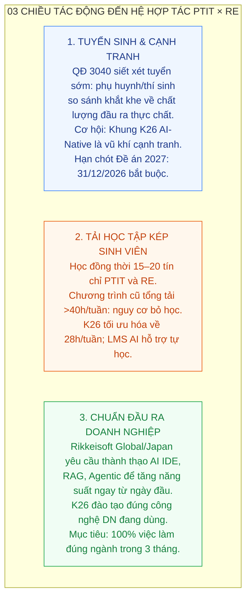
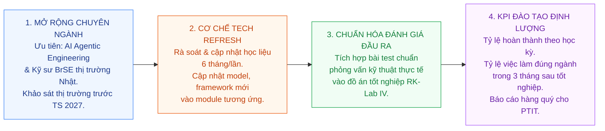
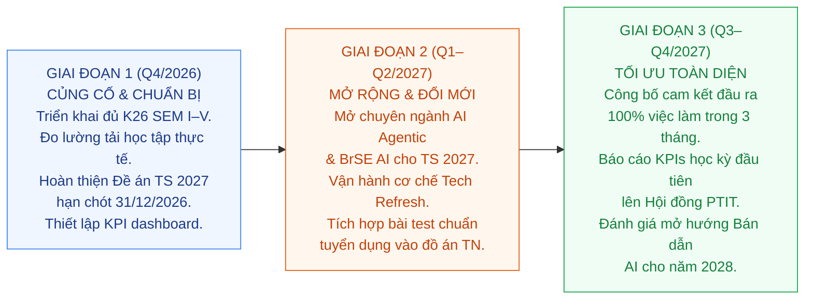

# BÁO CÁO CHIẾN LƯỢC: ĐÁNH GIÁ XU HƯỚNG GIÁO DỤC ĐẠI HỌC & PHƯƠNG HƯỚNG ĐỔI MỚI ĐÀO TẠO CNTT 2027
## Hệ Hợp tác Đào tạo – Rikkei Education × Học viện Công nghệ Bưu chính Viễn thông (PTIT)

- **Đơn vị chủ trì**: Bộ môn Công nghệ Thông tin – Rikkei Education (Rikkeisoft)
- **Đối tác liên kết**: Học viện Công nghệ Bưu chính Viễn thông (PTIT)
- **Phạm vi báo cáo**: Chuyên ngành CNTT – Hệ đào tạo liên kết RE × PTIT
- **Thời gian lập báo cáo**: Tháng 10/2026
- **Lưu ý**: Chương trình K26 đã được chốt và triển khai từ 2026. Báo cáo này tập trung phân tích chiến lược và xác định phương hướng đổi mới cho năm 2027.

---

## MỤC LỤC

1. Dự báo 04 Xu hướng Lớn của Giáo dục Đại học (2026–2030)
2. Dự báo Nhu cầu Nhân lực Kỹ sư AI-Native & Chuyên ngành Tiềm năng 2027
3. Đánh giá Ảnh hưởng đến Hệ PTIT của RE (03 Chiều tác động)
4. Phân tích Khoảng cách Năng lực (Gap Analysis): Chương trình cũ vs. Yêu cầu thị trường
5. Đánh giá Triển khai K26 (2026) & Phương hướng Đổi mới 2027
6. Các Nội dung Trọng tâm Thảo luận với Hội đồng PTIT
7. Hệ thống Căn cứ Pháp lý & Tài liệu Tham khảo

---

## PHẦN 1: DỰ BÁO 04 XU HƯỚNG LỚN CỦA GIÁO DỤC ĐẠI HỌC (2026–2030)

Giáo dục đại học Việt Nam, đặc biệt khối ngành Kỹ thuật – Công nghệ, đang tái cấu trúc sâu rộng dưới tác động đồng thời của chính sách quản lý nhà nước và làn sóng đột phá công nghệ AI.

| STT | Xu hướng | Nội dung cốt lõi | Số liệu dẫn chứng | Tác động đến RE × PTIT |
| :---: | :--- | :--- | :--- | :--- |
| **1** | **Siết quy chế & Minh bạch hóa tuyển sinh** | Tối đa 03 phương thức xét tuyển năm 2027; rút về 01 từ 2028. Bãi bỏ điểm cộng tự đặt. Bắt buộc công bố Đề án 2027 trước **31/12/2026**. | QĐ 3040/QĐ-BGDĐT ngày 19/10/2026 | **Ưu tiên cấp bách**: Hoàn thiện Đề án tuyển sinh trước hạn chót. Áp lực cạnh tranh buộc phải định vị chất lượng đầu ra thực chất. |
| **2** | **Đào tạo số hóa AI-First & Blended Learning** | Chuyển dịch sang Flipped Classroom và Adaptive Learning. LMS AI cá nhân hóa lộ trình học, hỗ trợ 24/7. Thời gian lên lớp tập trung hoàn toàn cho thực chiến & dự án. | WEF Future of Jobs 2025; UNESCO Digital Education 2024 | Mô hình K26 của RE đã triển khai đúng hướng. Cần tiếp tục hoàn thiện hạ tầng LMS AI. |
| **3** | **Tái định hình kỹ năng lập trình (GenAI)** | Đến 2028, **75% kỹ sư phần mềm** dùng AI Code Assistant trong quy trình sản xuất. Kỹ năng cốt lõi dịch chuyển sang Prompting, AI Pair-Programming, quản trị kiến trúc AI. | Gartner – Software Engineering Productivity 2024 | Chương trình cũ (100% code thủ công) đã lạc hậu. K26 đã khắc phục. Cần duy trì cập nhật liên tục. |
| **4** | **Đào tạo gắn doanh nghiệp (Work-Integrated Learning)** | Doanh nghiệp ưu tiên ứng viên sẵn sàng làm việc ngay (Zero-day Onboarding). Mô hình liên kết Viện – DN là lợi thế cạnh tranh tuyển sinh quyết định. | OECD Work-Integrated Learning 2024 | Hệ liên kết PTIT × RE là lời giải chuẩn xác, không có đối thủ tương đương trong hệ công lập thuần túy. |

---

## PHẦN 2: DỰ BÁO NHU CẦU NHÂN LỰC KỸ SƯ AI-NATIVE & CHUYÊN NGÀNH TIỀM NĂNG 2027

### 2.1. Chỉ số thị trường nhân lực CNTT (2026–2030)

| Chỉ số | Số liệu | Nguồn |
| :--- | :---: | :--- |
| Tốc độ tăng trưởng Kỹ sư AI hàng năm đến 2030 | **>30%/năm** | WEF Future of Jobs 2025 |
| Thiếu hụt kỹ sư CNTT tại Nhật Bản đến 2030 | **790.000 người** | METI Japan 2024 |
| Thị phần ITO Nhật Bản của Việt Nam | **>50%** | METI Japan 2024 |
| Chênh lệch lương khởi điểm Kỹ sư AI/LLMs vs. Web Dev truyền thống | **+25–35%** | TopDev Vietnam 2024 |
| Mục tiêu kỹ sư bán dẫn Việt Nam cần đào tạo đến 2030 | **50.000 người** | QĐ 1017/QĐ-TTg, 2024 |

### 2.2. Dự báo chuyên ngành đào tạo có nhu cầu cao (2027–2030)

| Chuyên ngành | Công nghệ trọng tâm | Tăng trưởng dự báo | Nguồn cầu tuyển dụng | Mức độ phù hợp RE × PTIT |
| :--- | :--- | :---: | :--- | :--- |
| **AI Application & Agentic Engineering** | LLMs, RAG, LangGraph, MCP, Python AI Stack | **>35%/năm** *(WEF 2025)* | Toàn cầu; Startup & Enterprise AI; Rikkeisoft Global | **Rất cao** — K26 đang đào tạo đúng hướng |
| **Cloud & LLMOps Engineering** | AWS/GCP, Docker/K8s, Semantic Caching, Guardrails | **>30%/năm** *(Gartner 2024)* | DN CNTT quy mô lớn; thị trường Nhật | **Cao** — SEM V K26 đã phủ; cần mở rộng |
| **Kỹ sư Cầu nối Quốc tế (BrSE AI)** | Tiếng Nhật IT, AI Communication, Cross-cultural PM | Thiếu 790K KS Nhật đến 2030 *(METI 2024)* | VN chiếm >50% ITO Nhật; Rikkeisoft Japan là kênh trực tiếp | **Cao** — Lợi thế đặc thù của RE × PTIT |
| **Thiết kế Vi mạch & AI Edge (Bán dẫn)** | VLSI, RISC-V, AI Chip Architecture, Embedded AI | 50.000 KS cần đến 2030 *(QĐ 1017/QĐ-TTg)* | NVIDIA, Samsung, Intel VN; nhà máy bán dẫn | **Trung bình** — Cần thêm hạ tầng lab; phù hợp liên kết PTIT |

> **Khuyến nghị**: Ưu tiên mở rộng hướng *AI Application & Agentic* và *BrSE AI* cho tuyển sinh 2027 — hai hướng RE có lợi thế cạnh tranh rõ ràng nhất và không đòi hỏi đầu tư hạ tầng lớn.

---

## PHẦN 3: ĐÁNH GIÁ ẢNH HƯỞNG ĐẾN HỆ PTIT CỦA RE (03 CHIỀU TÁC ĐỘNG)

| Chiều tác động | Thực trạng & Thách thức | Cơ hội & Lợi thế | Hành động ưu tiên 2027 |
| :--- | :--- | :--- | :--- |
| **1. Tuyển sinh & Cạnh tranh** | QĐ 3040 siết xét tuyển sớm; thí sinh chọn lọc khắt khe về chất lượng đầu ra. Áp lực cạnh tranh tăng cao. | Khung K26 chuẩn AI-Native là điểm khác biệt quyết định. Hệ liên kết Viện–DN không trường công lập nào có. | Hoàn thiện Đề án tuyển sinh 2027 **trước 31/12/2026**. Xây thông điệp định vị: *"Học xong có việc làm AI chuẩn thị trường."* |
| **2. Tải học tập & Giữ chân SV** | SV học đồng thời PTIT và RE. Tải cũ >40h/tuần dẫn đến nguy cơ bỏ học, đặc biệt SEM II–III. | K26 tối ưu thời lượng xuống ~28h/tuần. LMS AI tự động hóa chấm bài, cảnh báo sớm. | Đo lường tải học tập thực tế SEM I. Duy trì ≤30h/tuần và hiệu chỉnh ngay nếu vượt ngưỡng. |
| **3. Chuẩn đầu ra & Việc làm** | DN CNTT đòi hỏi thành thạo AI IDE, RAG, Agentic. Chương trình cũ không đáp ứng; DN phải đào tạo lại 6–9 tháng. | SV K26 được đào tạo đúng công nghệ DN đang dùng. Rikkeisoft Global/Japan là kênh tuyển dụng trực tiếp. | Thiết lập cam kết đầu ra. Phối hợp PTIT tổ chức ngày hội tuyển dụng riêng hệ liên kết. |

---

## PHẦN 4: PHÂN TÍCH KHOẢNG CÁCH NĂNG LỰC (GAP ANALYSIS)

So sánh giữa chương trình cũ và yêu cầu thị trường tuyển dụng — cơ sở cho các quyết định đổi mới 2027.

| Tiêu chí đánh giá | Chương trình cũ (trước K26) | Yêu cầu thị trường 2026–2027 | Trạng thái K26 |
| :--- | :--- | :--- | :--- |
| **Công nghệ cốt lõi** | C, Java OOP, Spring Boot truyền thống. Không có AI, Python AI, Vector DB. | Python/FastAPI, AI Prompting, RAG, LangChain, pgvector, LLMOps trên Cloud. | ✅ Đã cập nhật đầy đủ trong K26. |
| **Phương pháp lập trình** | 100% viết tay thủ công. Không AI IDE, không Pair-Programming với AI. | AI Pair-Programming (Cursor/Windsurf), Prompt Engineering, AI-first Dev workflow. | ✅ Tích hợp từ SEM I trong K26. |
| **Tỷ lệ lý thuyết / thực hành** | 40–45% lý thuyết thụ động. 18,7h/tuần tại lớp; tổng tải >40h/tuần. | Thực hành >60%. Tổng tải ≤30h/tuần. Dự án sản phẩm kế thừa xuyên suốt. | ✅ K26 tái cân bằng; LMS AI hỗ trợ tự học. |
| **Tính kế thừa sản phẩm** | Bài tập rời rạc, không sản phẩm hoàn chỉnh cuối khóa. Thiếu quy trình Agile/Scrum. | Sản phẩm mỗi kỳ là đầu vào của kỳ sau. Đồ án tốt nghiệp chuẩn Production-Ready. | ✅ Chuỗi RK-Lab I→IV kế thừa xuyên suốt. |
| **AI chuyên sâu** | Không có module AI chuyên ngành. Không RAG, không Agentic, không LLMOps. | AI App Dev (RAG), Agentic/MCP, Multi-Agent LangGraph, LLMOps, Cloud Deploy. | ✅ SEM III–V của K26 phủ đầy đủ. |

### So sánh tải học tập: Chương trình cũ vs. Khung K26

| Chỉ số | Chương trình cũ | Khung K26 | Mức độ cải thiện |
| :--- | :---: | :---: | :--- |
| Thời lượng học tại lớp (RE) | **18,7h/tuần** | **~12h/tuần** | Giảm 36% |
| Tỷ lệ lý thuyết thụ động | **40–45%** | **10–15%** | Giảm 75% |
| Tỷ lệ thực hành & đồ án | **55%** | **85–90%** | Tăng gần gấp đôi |
| Tổng tải học tập (RE + PTIT) | **>40h/tuần** | **~28h/tuần** | Giảm 33% |
| Hỗ trợ giải đáp ngoài giờ | Thủ công, chờ lịch | AI Assistant 24/7 | Cải thiện căn bản |

---

## PHẦN 5: ĐÁNH GIÁ TRIỂN KHAI K26 (2026) & PHƯƠNG HƯỚNG ĐỔI MỚI 2027

> **Lưu ý**: Chương trình K26 đã được chốt và triển khai. Phần này tập trung đánh giá những điểm đã làm tốt, những điểm cần theo dõi và các phương hướng chiến lược mới cho năm 2027.

### 5.1. Đánh giá nhanh kết quả triển khai K26 (2026)

| Yếu tố | Đánh giá | Ghi chú |
| :--- | :---: | :--- |
| Tích hợp AI từ SEM I (Prompting, AI-Pair Programming) | ✅ Tốt | Phù hợp xu hướng toàn cầu theo Gartner, WEF |
| Chuỗi RK-Lab sản phẩm kế thừa xuyên suốt | ✅ Tốt | Tăng tính thực chiến, giảm lý thuyết thụ động |
| Chuyển sang Python/FastAPI thay Java truyền thống | ✅ Tốt | Đúng stack AI-Native thị trường hiện tại |
| LLMOps + Cloud Deployment (SEM V) | ✅ Tốt | Hiếm chương trình ĐH nào có tại Việt Nam |
| Đo lường tải học tập thực tế sinh viên | ⚠️ Cần theo dõi | Nguy cơ quá tải ở SEM II–III |
| Cập nhật công nghệ AI thay đổi nhanh | ⚠️ Cần cơ chế | Nếu không có quy trình, chương trình lạc hậu trong 1–2 năm |

### 5.2. Phương hướng đổi mới chiến lược 2027

| STT | Phương hướng | Nội dung cụ thể | Thời hạn |
| :---: | :--- | :--- | :--- |
| **1** | **Dự báo & mở chuyên ngành mới** | Khảo sát thị trường chuyên ngành AI Agentic và BrSE AI. Xây dựng chương trình thí điểm cho tuyển sinh 2027. Đánh giá khả thi bán dẫn AI giai đoạn 2028. | Q4/2026 – Q1/2027 |
| **2** | **Cơ chế Tech Refresh học liệu** | Thiết lập quy trình rà soát và cập nhật nội dung 6 tháng/lần. Khi có model/framework mới đủ quan trọng, cập nhật ngay vào module tương ứng trong học kỳ đang chạy. | Q1/2027 |
| **3** | **Tăng cường đánh giá theo chuẩn tuyển dụng** | Tích hợp bài test năng lực chuẩn phỏng vấn kỹ thuật thực tế vào đồ án tốt nghiệp RK-Lab IV. Hợp tác doanh nghiệp để xác nhận chuẩn đầu ra. | Q2/2027 |
| **4** | **Xây dựng hệ thống KPI đào tạo** | Tỷ lệ hoàn thành theo học kỳ, tỷ lệ việc làm đúng ngành trong 3 tháng sau tốt nghiệp, mức lương khởi điểm trung bình. Báo cáo hàng quý cho Hội đồng PTIT. | Q1/2027 |

### 5.3. Lộ trình triển khai 03 giai đoạn

---

## PHẦN 6: CÁC NỘI DUNG TRỌNG TÂM THẢO LUẬN VỚI HỘI ĐỒNG PTIT

| STT | Trọng tâm thảo luận | Nội dung kiến nghị | Mục tiêu cần đạt |
| :---: | :--- | :--- | :--- |
| **01** | **Đồng bộ thời khóa biểu & Công nhận tín chỉ** | Thống nhất lịch học tại lớp của RE không trùng lịch thi và lịch học chính khóa PTIT. Đề xuất PTIT xem xét công nhận tương đương tín chỉ cho các học phần thực hành dự án và kỳ thực tập RK-Lab Internship (RK-101 đến RK-104). | Tổng tải học tập sinh viên **≤ 30 giờ/tuần**; hạn chế tối đa nguy cơ kiệt sức và nợ môn. |
| **02** | **Liên thông dữ liệu đánh giá học tập** | Kết nối API dữ liệu học tập giữa LMS AI của RE và cổng quản trị đào tạo PTIT. Công nhận kết quả Autograder và điểm chuyên cần trên LMS AI làm căn cứ xét điểm quá trình chính thức. | Minh bạch hóa đánh giá năng lực; hiện đại hóa quy trình quản trị đào tạo theo chuẩn số. |
| **03** | **Nâng cao tỷ lệ hoàn thành & Đầu ra việc làm** | Thiết lập kênh kết nối từ Early Warning Dashboard để cùng can thiệp sinh viên có nguy cơ thôi học. Phối hợp tổ chức ngày hội tuyển dụng kết nối sinh viên tốt nghiệp với Rikkeisoft Global và đối tác công nghệ. | Tỷ lệ thôi học **<10%**; **100%** việc làm đúng ngành trong vòng 3 tháng sau tốt nghiệp. |

---

## PHẦN 7: HỆ THỐNG CĂN CỨ PHÁP LÝ & TÀI LIỆU THAM KHẢO

### 7.1. Văn bản quy phạm pháp luật

| Văn bản | Nội dung liên quan |
| :--- | :--- |
| **QĐ 3040/QĐ-BGDĐT** (19/10/2026) | Kế hoạch tuyển sinh đại học 2027: tối đa 03 phương thức; hạn chốt Đề án 31/12/2026. |
| **QĐ 1017/QĐ-TTg** (21/09/2024) | Chương trình phát triển nhân lực ngành bán dẫn đến 2030: mục tiêu 50.000 kỹ sư. |
| **QĐ 1018/QĐ-TTg** (21/09/2024) | Chiến lược phát triển ngành công nghiệp bán dẫn Việt Nam đến 2030, tầm nhìn 2050. |
| **NĐ 13/2023/NĐ-CP** (17/04/2023) | Bảo vệ dữ liệu cá nhân — liên quan đến khai thác dữ liệu học tập LMS AI. |

### 7.2. Báo cáo thị trường & nghiên cứu uy tín

| Nguồn | Nội dung trích dẫn chính |
| :--- | :--- |
| **Gartner – Software Engineering Productivity (2024)** | 75% kỹ sư phần mềm dùng AI Code Assistant vào 2028. |
| **WEF – Future of Jobs Report (2025)** | Kỹ sư AI tăng trưởng >30%/năm đến 2030; nhóm tăng trưởng nhanh nhất toàn cầu. |
| **METI Japan – ICT Human Resources Survey (2024)** | Thiếu hụt 790.000 kỹ sư CNTT tại Nhật đến 2030; VN chiếm >50% thị phần ITO. |
| **TopDev Vietnam – IT Report (2024)** | Kỹ sư AI/LLMs và Cloud/DevOps lương khởi điểm cao hơn 25–35% so với Web Dev truyền thống. |
| **UNESCO Digital Education (2024)** | Blended Learning và AI-First là xu hướng đào tạo kỹ thuật toàn cầu 2025–2030. |
| **OECD – Work-Integrated Learning (2024)** | Mô hình WIL (Viện – DN) là tiêu chuẩn đào tạo kỹ thuật chất lượng cao ở các nền kinh tế OECD. |

---

*Báo cáo do Bộ môn CNTT – Rikkei Education lập, tháng 10/2026. Tài liệu phục vụ nội bộ và thảo luận với Hội đồng PTIT.*
